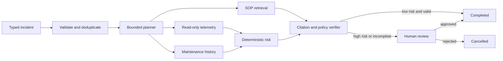

# RAG Agent 可驗證工作流

一套可在本機完整執行的營運事件調查平台。系統將事件驗證、有界任務規劃、唯讀資料工具、SOP 檢索、風險計算、結果驗證、失敗重試、人工核准與稽核軌跡串成一條可恢復工作流。

> 專案狀態：公司實務版 v1.0.0。預設離線、零 API 費用；Git 內資料及 SOP 均為原創示範內容，不含私人資料、客戶資料或未授權素材。

## 使用情境

營運、維護或支援團隊收到設備異常事件後，需要回答三個問題：目前有哪些可信證據、下一步可安全執行什麼，以及何時必須交由人員核准。單次文字生成無法處理工具失敗、重複請求、資料缺漏或高風險核准，因此本作品把生成視為工作流中的可替換節點，並由確定性的安全邊界控制交付。

| 項目 | 定義 |
|---|---|
| 事件輸入 | 資產 ID、發生時間、症狀、嚴重度、調查問題與 idempotency key |
| 資料輸入 | 唯讀遙測、歷史維護事件、原創通用 SOP；可選 UCI AI4I 公開資料 |
| 核心處理 | 驗證 → 有界規劃 → allowlisted tools → retry → 風險規則 → 引用驗證 → 人工 gate |
| 主要輸出 | 結構化建議、風險、處置步驟、證據引用、限制與人工核准需求 |
| 工程輸出 | 狀態轉移、工具參數與結果、attempt、延遲、錯誤、trace ID 與 Prometheus 指標 |
| 失敗策略 | 工具 timeout／暫時錯誤有限重試；證據不足轉人工；未知錯誤 fail closed |

## 核心能力

- FastAPI 與 Pydantic 的嚴格 REST 契約，不接受任意 SQL、工具名稱或外部 URL。
- 有界 planner 固定最大步數，只能選擇遙測、維護紀錄、SOP 檢索及風險計算工具。
- SQLite 工作流紀錄、idempotency key、狀態事件、工具 attempt、trace 與人工決策。
- 原創 SOP 的詞彙檢索、來源白名單及引用完整性驗證。
- transient failure injection、指數退避、有限重試、失敗後 resume 及成功工具結果重用。
- 高風險、缺少遙測或驗證未通過時強制 `needs_review`，不自動執行外部動作。
- `admin`、`operator`、`reviewer`、`viewer` 四種本機示範角色與 API 權限。
- 響應式操作介面、OpenAPI、JSON 指標、Prometheus 文字指標及健康檢查。
- CLI、離線驗收題集、UCI AI4I adapter、Docker、Kubernetes 範例、CI 與隱私掃描。

## 工作流



狀態、故障邊界與資料責任見 [`docs/architecture.md`](docs/architecture.md)。

## 五分鐘離線 Demo

需求：Python 3.11+。

```powershell
python -m venv .venv
.\.venv\Scripts\Activate.ps1
python -m pip install --upgrade pip
python -m pip install -r requirements-lock.txt
python -m pip install --no-deps -e .
opsflow doctor
opsflow run-demo --scenario critical
opsflow evaluate
```

啟動 API 與操作介面：

```powershell
opsflow serve
```

- Web：`http://127.0.0.1:8000`
- OpenAPI：`http://127.0.0.1:8000/docs`
- 健康檢查：`http://127.0.0.1:8000/healthz`
- Prometheus 指標：`http://127.0.0.1:8000/metrics`

操作介面預設以 `operator` 建立任務；高風險結果須切換為 `reviewer` 或 `admin` 才能核准。

## CLI

```powershell
opsflow doctor
opsflow init-db
opsflow run-demo --scenario normal
opsflow run-demo --scenario critical
opsflow evaluate --output outputs/evaluation-report.json
opsflow import-ai4i data/raw/ai4i2020.csv
opsflow serve --host 127.0.0.1 --port 8000
```

所有命令可用 `--database` 指定獨立 SQLite 檔案，方便測試與展示：

```powershell
opsflow --database outputs/demo.db run-demo --scenario critical
```

## 公開資料

選配資料為 [UCI AI4I 2020 Predictive Maintenance Dataset](https://archive.ics.uci.edu/dataset/601/ai4i)，授權為 CC BY 4.0。完整資料不提交 Git；下載後放在 `data/raw`。adapter 會依產品類型建立明確標示的示範時間線，不把轉換後資料宣稱為真實現場遙測。細節見 [`data/README.md`](data/README.md)。

即使未下載公開資料，內建原創 fixture 仍可完整執行 API、工作流、重試、核准及評測。

## 自動驗證

```powershell
python -m compileall -q src
python -m ruff check src tests
python -m mypy src
python -m pytest --cov=opsflow_agent --cov-report=term-missing
opsflow evaluate
.\scripts\privacy-check.ps1
```

`scripts/verify.ps1` 會一次執行上述建置、靜態檢查、測試、評測與隱私掃描。

### v1.0.0 可重現基準

| 檢查 | 結果 |
|---|---:|
| pytest | 22 passed |
| Python coverage | 90% |
| Ruff | passed |
| mypy | passed |
| 離線驗收案例 | 3/3 passed |
| AI4I adapter 實測 | 10,000 rows imported；339 failure rows |
| wheel / sdist | built and wheel installed in an isolated environment |
| 瀏覽器端到端 | critical evidence → human review → reviewer approval passed |

這些數字證明軟體流程可重現，不代表真實設備的診斷準確率或安全認證。

## Docker

```powershell
docker compose up --build
```

服務會在 `http://localhost:8000` 啟動，SQLite 資料保存於具名 volume。此 Compose 設定是單節點作品展示，不宣稱具備多副本資料庫能力。

`infra/k8s` 提供健康探針、非 root、唯讀根檔案系統及單副本部署範例。正式多副本環境應先將工作流儲存改成 PostgreSQL 或受管資料庫。

## 專案結構

```text
src/opsflow_agent/       API、CLI、資料層、工具、工作流、評測及 Web UI
tests/                   單元、API、復原、資料匯入與端到端測試
src/opsflow_agent/resources/sops/  隨套件安裝的原創通用 SOP fixture
examples/evals/          原創離線驗收案例
data/                    公開資料授權與本機下載位置
docs/                    架構、安全、評測、操作與限制
infra/k8s/               單副本展示 manifests
scripts/                 下載、驗證與隱私掃描
outputs/                 Git 忽略的執行產出
```

## 已知限制

- 目前 SQLite 適合單節點展示，不支援多 worker 同時 claim 任務。
- 本機 Header 身分只為作品 Demo；正式環境必須改成 OIDC/OAuth2、JWT 驗證與組織角色。
- v1 使用確定性 planner 與風險／摘要 fallback，讓離線測試可重現；LLM planner 可透過獨立 adapter 加入，但不得繞過工具 allowlist、引用 verifier 或人工 gate。
- SOP 檢索是小型集合詞彙排名；大型知識庫應改用版本化 embedding、向量索引與 retrieval 評測。
- 示範風險門檻不是設備規格，處置建議不取代核准程序或專業判斷。
- Docker 與 Kubernetes 檔案已提供，但本機未安裝 Docker，因此交付時只能做靜態設定檢查。

完整限制與下一步見 [`docs/limitations.md`](docs/limitations.md)。

## 授權

程式碼、原創 SOP 與原創評測案例使用 [MIT License](LICENSE)。第三方套件與選配公開資料的授權摘要見 [THIRD_PARTY_NOTICES.md](THIRD_PARTY_NOTICES.md)。密碼、Key、Token、私人資料、執行期資料庫、下載資料與大型輸出均不納入 Git。
